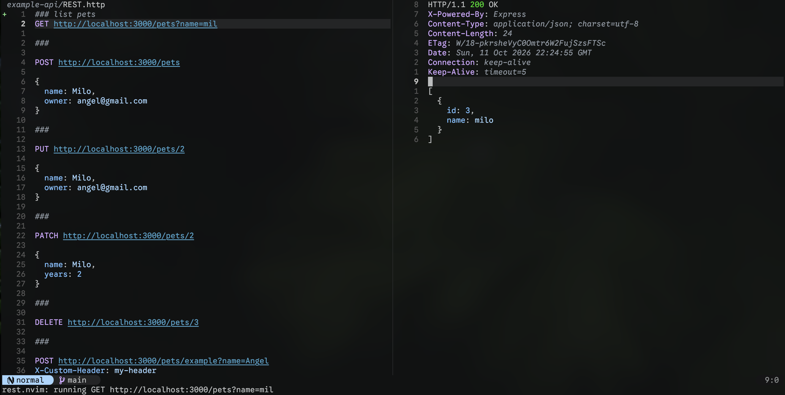
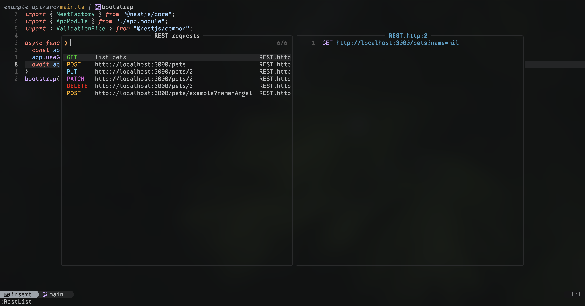

# rest.nvim

[](https://github.com/radagva/rest.nvim/actions/workflows/ci.yml) [](https://github.com/radagva/rest.nvim/tags)

A REST client for Neovim. Reads `.http` files, executes the request under the
cursor, and shows the response (written in pure Lua with zero Lua/library
dependencies).



## Requirements

- Neovim **0.12+**
- `curl` (transport)
- `jq` (optional; pretty-prints JSON responses; falls back to a built-in
  renderer when absent)

## Installation

Add the plugin with Neovim's native package manager (`vim.pack`, Neovim
0.12+):

```lua
vim.pack.add({ "https://github.com/radagva/rest.nvim" })
```

With [lazy.nvim](https://github.com/folke/lazy.nvim):

```lua
{
  "radagva/rest.nvim",
  -- optional: with `opts`, lazy.nvim calls require("rest").setup(opts)
  opts = {},
}
```

Or clone the repository anywhere and prepend it to `'runtimepath'`:

```lua
vim.opt.runtimepath:append("~/path/to/rest.nvim")
```

There are no Lua dependencies; see [Requirements](#requirements) for `curl`
and the optional `jq`.

## Configuration

Calling `setup()` is optional (the defaults below apply out of the box).
Override only what you need:

```lua
require("rest").setup({
  base_url = nil,             -- prefix for relative request URLs
  timeout_s = 30,             -- curl --max-time in seconds
  follow_redirects = false,   -- pass curl -L
  verify_tls = true,          -- false to pass curl -k
  cookies = {                 -- cookie jar (see Cookies)
    enabled = false,          -- pass -b/-c to every request
    path = nil,               -- jar file (default: session-only temp jar)
  },
  jq_path = nil,              -- jq binary (default: auto-detect on $PATH)
  ui = { split = "vertical" }, -- response split: "vertical" | "horizontal"
  list = {
    picker = "auto",          -- "auto" | "snacks" | "telescope" | "fzf" | "select"
    dirs = { "." },           -- directories scanned by :RestList
  },
})
```

| Option             | Type       | Default      | Description                                                                                                                  |
| ------------------ | ---------- | ------------ | ---------------------------------------------------------------------------------------------------------------------------- |
| `base_url`         | `string?`  | `nil`        | Prefix for relative request URLs (e.g. `https://api.example.com`).                                                           |
| `timeout_s`        | `number`   | `30`         | Request timeout, passed to `curl --max-time`.                                                                                |
| `follow_redirects` | `boolean`  | `false`      | Follow redirects (`curl -L`).                                                                                                |
| `verify_tls`       | `boolean`  | `true`       | Verify TLS certificates; `false` passes `curl -k`.                                                                           |
| `cookies.enabled`  | `boolean`  | `false`      | Maintain a cookie jar across requests (see [Cookies](#cookies)).                                                             |
| `cookies.path`     | `string?`  | `nil`        | Cookie jar file; `nil` uses a session-only temporary jar.                                                                    |
| `jq_path`          | `string?`  | `nil`        | Explicit `jq` binary; by default jq is auto-detected on `$PATH`.                                                             |
| `ui.split`         | `string`   | `"vertical"` | Response split direction: `"vertical"` or `"horizontal"`.                                                                    |
| `list.picker`      | `string`   | `"auto"`     | `:RestList` backend: `"auto"`, `"snacks"`, `"telescope"`, `"fzf"` or `"select"` (see [Listing requests](#listing-requests)). |
| `list.dirs`        | `string[]` | `{ "." }`    | Directories scanned recursively by `:RestList`; relative paths resolve against the current working directory.                |

## Usage

| Command            | Description                                                            |
| ------------------ | ---------------------------------------------------------------------- |
| `:RestRun`         | Run the `.http` request under the cursor                               |
| `:RestList`        | Pick a request from all `.http` files under `list.dirs` and jump to it |
| `:RestCopyCurl`    | Copy the request under the cursor as a curl command                    |
| `:RestImportCurl`  | Insert a curl command from the clipboard as a `.http` request          |
| `:RestCookiesClear` | Delete the cookie jar (see [Cookies](#cookies))                      |
| `:RestEnv`          | Show or switch the active environment (see [Environments](#environments)) |

Open a `.http` file and run the request under the cursor:

```http
@host = https://api.example.com

### list users
GET $host/users
Accept: application/json
```

```vim
:RestRun
```

`:RestRun` parses the buffer, resolves `$name` references defined as
`@name = value`, sends the request with `curl`, and opens the response in a
split (`rest://response`). The body is syntax-highlighted by content type
(treesitter when a parser is installed; status and headers stay dimmed).

## curl interop

`:RestCopyCurl` renders the request under the cursor (variables resolved)
as a single-line, shell-quoted curl command and copies it to the system
clipboard (`+`), ready to paste into a terminal; it also lands in the
unnamed register for pasting inside Neovim.

`:RestImportCurl` goes the other way: copy a command from browser DevTools
and insert it as a `.http` request. It reads the clipboard first and falls
back to a prompt when the clipboard does not hold a curl command. Common
flags are understood (`-X`, `-H`, `-d*`, `--json`, `-A`, `-b`, `-e`, `-u`,
`-I`, `-G`, `--url`), repeated `-d` is joined with `&` as curl does, and
`-u user:pass` becomes a `Basic` authorization header.

## Listing requests



`:RestList` scans every `*.http` file under the configured directories
(recursive, skipping `.git/` and `node_modules/`) and shows all of their
endpoints in a picker:

```
GET   list users      api/users.http
POST  login           auth.http
GET   https://api.example.com/health  api/health.http
```

Each row is `METHOD  NAME  FILE`, with the method and name columns padded to
align. The name is the request's `### name`, falling back to its `@name
<tag>`, and then to its URL (with `$name` references resolved when possible).
The method is colorized (see [Highlighting](#highlighting)). Picking a row
opens that file with the cursor on the request's line, ready for `:RestRun`.

Backends with a preview window (snacks, telescope, fzf-lua) show the selected
request's source lines: snacks and telescope highlight them with treesitter
when the `http` parser is installed (falling back to plain syntax
otherwise), fzf-lua shows plain text in fzf's preview pane, and vanilla
`vim.ui.select` has no preview.

The picker backend is configurable (`list.picker`): `"snacks"`,
`"telescope"`, `"fzf"` (fzf-lua) or `"select"` (`vim.ui.select`). The default,
`"auto"`, picks the first backend that is installed in that order, falling
back to `vim.ui.select`.

Supported `.http` features: `###` request separators (with optional names),
`#`/`//` comments, `@name = value` file variables (values may derive from
other references), `@name <tag>` request tags,
`$name` substitution in URL/headers/body (concatenates inside quoted strings),
request headers and raw bodies (RFC 9112 message shape).

A `$` not followed by a letter or underscore is left as-is (`$99.99`, `$5`),
so JSON bodies with prices stay intact. Write `$$word` for a literal `$word`.

## Plugin globals

The `$_` prefix is reserved for plugin globals. `$_now` resolves to the
moment the request is resolved, as a local ISO 8601 timestamp
(`2026-10-15T14:30:05`); its fields are the zero-padded components of that
same string:

| Path           | Value                 |
| -------------- | --------------------- |
| `$_now`        | `2026-10-15T14:30:05` |
| `$_now.year`   | `2026`                |
| `$_now.month`  | `10`                  |
| `$_now.day`    | `15`                  |
| `$_now.hour`   | `14`                  |
| `$_now.minute` | `30`                  |
| `$_now.second` | `05`                  |

Fields shift with `.add(n)` / `.sub(n)` (integer `n`); the result is the
full timestamp after calendar normalization, so it is always a valid time.
All `$_now` references inside one request see the same instant:

```http
POST https://api.example.com/sessions
Content-Type: application/json

{"issuedAt": "$_now", "expiresAt": "$_now.hour.add(2)", "validUntil": "$_now.day.add(7)"}
```

`$_now.hour.add(4)` at 23:30 rolls into the next day at 03:30, and
`$_now.month.add(1)` on Jan 31 clamps to Feb 28 (29 in a leap year).

The same shifts exist as methods directly on `$_now`, chainable in written
order. Each link applies to the result of the previous one, and a chain may
end with a field access:

| Method                      | Shifts  |
| --------------------------- | ------- |
| `addHours(n)` / `subHours(n)`     | hours   |
| `addMinutes(n)` / `subMinutes(n)` | minutes |
| `addSeconds(n)` / `subSeconds(n)` | seconds |
| `addDays(n)` / `subDays(n)`       | days    |
| `addMonths(n)` / `subMonths(n)`   | months  |
| `addYears(n)` / `subYears(n)`     | years   |

```http
POST https://api.example.com/sessions
Content-Type: application/json

{"issuedAt": "$_now", "expiresAt": "$_now.addHours(4).addMinutes(2)", "remindOn": "$_now.addDays(7).day"}
```

Chains are order-sensitive: from Jan 31, `$_now.addMonths(1).addMonths(1)`
lands on Mar 28, while `$_now.addMonths(2)` lands on Mar 31. Text after a
chain that is not part of it stays literal, so `$_now.addHours(1).json`
keeps the `.json` suffix.

Because the prefix is reserved, defining a variable whose name starts with
`_` (a file-level `@_name = value` or an environment variable in
`rest-env.json`) raises a warning and stops the request.

Definition values are references too (derived variables): other
definitions, environment values, previous responses and `$_` globals are
all legal inside a `@name = value`, and they resolve when the request
runs, so every `$_now` in one request (including derived ones) is the
same instant:

```http
@host = https://api.example.com
@utctime = $_now.hour.add(4)
@path = $host/time

GET $path
X-Utc-Time: $utctime
```

Definitions may reference each other in any order; errors inside a value
are reported as `definition '<name>': <error>`, and one that ends up
referencing itself (directly or through others) is reported as
`circular definition: <path>`.

## Chaining requests

Tag a request with `@name <tag>` (before its request line). Once that request
has run, its response is available to any later request through
`$<tag>.response.<path>`:

```http
@name signin
POST $host/login
Content-Type: application/json

{"user": "root", "pass": "secret"}

### run the request above first
GET $host/me
Authorization: Bearer $signin.response.body.accessToken
```

| Path                          | Value                                                                                                         |
| ----------------------------- | ------------------------------------------------------------------------------------------------------------- |
| `$tag.response.body`          | raw response body                                                                                             |
| `$tag.response.body.field`    | JSON field (`.` for nesting; keys are matched case-insensitively; objects/arrays are inlined as compact JSON) |
| `$tag.response.body[0].field` | array element (**0-based**; `.0` also works; `[0][1]` chains)                                                 |
| `$tag.response.headers.Name`  | header value (name is case-insensitive)                                                                       |
| `$tag.response.status`        | status code                                                                                                   |
| `$tag.response.version`       | HTTP version                                                                                                  |
| `$tag.response.reason`        | reason phrase                                                                                                 |
| `$tag.response.url`           | final URL                                                                                                     |

Responses are kept in memory for the current session: the tagged request must
have been run before (otherwise resolution fails with
`undefined response '<tag>'`). File definitions win over response refs of the
same name.

## Cookies

With `cookies.enabled`, every request passes a Netscape cookie jar to curl
(`-b`/`-c`), so `Set-Cookie` values from a login response flow into later
requests. By default the jar is a session-only temporary file (nothing is
written to a stable path); set `cookies.path` to persist it across Neovim
sessions.

`:RestCookiesClear` deletes the jar (session or configured path).

## Environments

Variables can come from a `rest-env.json` file, searched upward from the
working directory (project roots work without any config):

```json
{
  "default": "dev",
  "environments": {
    "dev": { "host": "http://localhost:8000", "token": "dev-secret" },
    "prod": { "host": "https://api.example.com", "token": "prod-secret" }
  }
}
```

Requests resolve `$host`, `$token`, ... from the active environment: the
file's `default` unless `:RestEnv` switches it. File-level `@definitions` and
response references still win over environment variables of the same name.

- `:RestEnv` opens a picker over the environments (plus `(none)` to disable
  environments for the session).
- `:RestEnv prod` switches directly and reports how many variables are active.

## Highlighting

The response UI exposes these highlight groups. All are defined with
`default = true`, so your colorscheme can override them (e.g. from its
`on_highlights`):

| Group                       | Applies to                   | Default                     |
| --------------------------- | ---------------------------- | --------------------------- |
| `RestStatusCodeInformation` | `1xx` status code            | white                       |
| `RestStatusCodeSuccess`     | `2xx` status code            | green                       |
| `RestStatusCodeRedirect`    | `3xx` status code            | amber                       |
| `RestStatusCodeError`       | `4xx` status code            | red                         |
| `RestStatusCodeServerError` | `5xx` status code            | black on red                |
| `RestHeadingsAttributes`    | header names                 | links to `@function.method` |
| `RestHeadingsValues`        | header values                | links to `Comment`          |
| `RestMethod`                | other methods in `:RestList` | links to `@function.method` |
| `RestMethodGet`             | `GET` in `:RestList`         | green                       |
| `RestMethodPost`            | `POST` in `:RestList`        | amber                       |
| `RestMethodPut`             | `PUT` in `:RestList`         | light blue                  |
| `RestMethodPatch`           | `PATCH` in `:RestList`       | magenta                     |
| `RestMethodDelete`          | `DELETE` in `:RestList`      | red                         |
| `RestMethodHead`            | `HEAD` in `:RestList`        | pale blue                   |
| `RestMethodOptions`         | `OPTIONS` in `:RestList`     | yellow                      |
| `RestMethodTrace`           | `TRACE` in `:RestList`       | grey                        |
| `RestMethodConnect`         | `CONNECT` in `:RestList`     | grey                        |

```lua
on_highlights = function(hl, colors)
  hl.RestStatusCodeSuccess = { fg = colors.green }
  hl.RestStatusCodeServerError = { fg = colors.bg, bg = colors.red }
  hl.RestHeadingsValues = { fg = colors.fg_dim }
  hl.RestMethodGet = { fg = colors.green, bold = true }
  hl.RestMethodDelete = { fg = colors.red, bold = true }
end
```

The rest of the status line (`HTTP/1.1`, reason phrase) stays plain `Normal`;
the response body is handled by treesitter for its content type.

## Development

```sh
brew install stylua luacheck busted   # tooling

make check    # stylua . && luacheck . && busted
make smoke    # headless end-to-end run against example.com
```

Tests live in `tests/` (busted); `.http` fixtures in `tests/fixtures/`.

## About

This plugin only exists because I wanted to create my own REST client; it is
planned to be simple by default.

Inspirations:

- [dont-be-evil-company/kulala.nvim](https://github.com/dont-be-evil-company/kulala.nvim)
- [rest-nvim/rest.nvim](https://github.com/rest-nvim/rest.nvim)

## License

[MIT](LICENSE)
